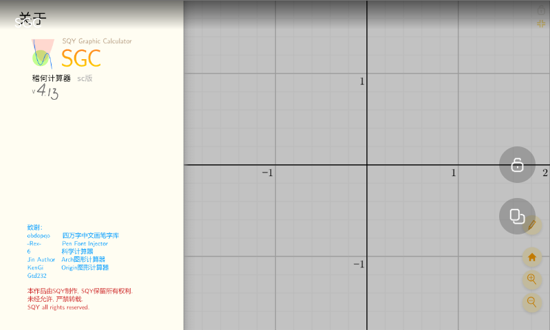

# 反馈与致谢

## 反馈

遇到问题请尽量附上这些信息，方便定位：

- SGC 版本号；
- 出问题的表达式原文；
- 当时的设置；
- 一张截图；
- 是否能稳定复现。

反馈渠道：

- 仓库：[SQY419/SQY419.github.io](https://github.com/SQY419/SQY419.github.io)

<figure markdown>
  { width="420" }
  <figcaption>关于页：版本号、致谢与版权信息</figcaption>
</figure>

SGC v4 基于 Scratch 构造，受平台限制一定还有不少缺陷，遇到问题请直接和 SQY 反馈。

## 致谢

- turbowarp.org、GitHub Pages、gtd232（美西螈力量）
- Obdopqo：四万字超大画笔字库与示例字库、多边形填充与点击判断
- Alpha Math、Origin 图形计算器：同类优质作品，交流互鉴
- “6”的科学计算器：公式渲染器、幂的计算、傅里叶变换音乐生成器
- 其他为 SGC 开发做出贡献的开发者

使用了以下非原创内容：

- CMU Sans Serif、CMU Serif、JetBrains Mono 等字体
- Obdopqo 的多边形填充与点击判断、四万字超大画笔字库
- -Rex- 的 SFE 字符注入器

## 关于后续版本

SGC v5 的 JavaScript 版本正在制作中。