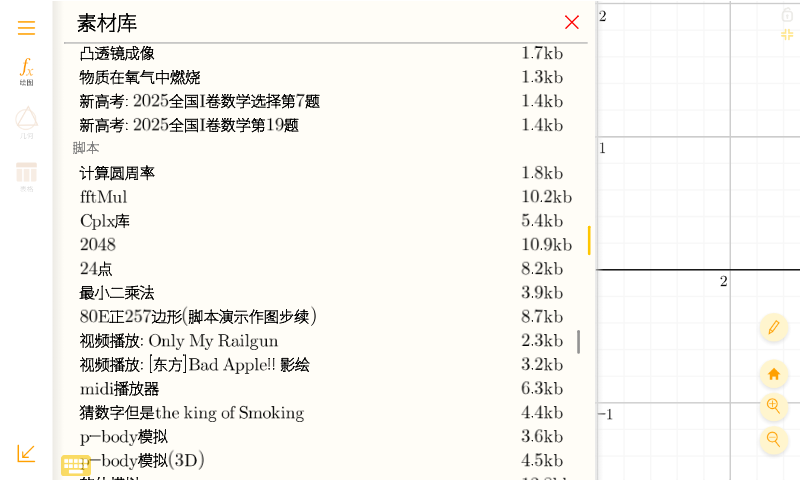
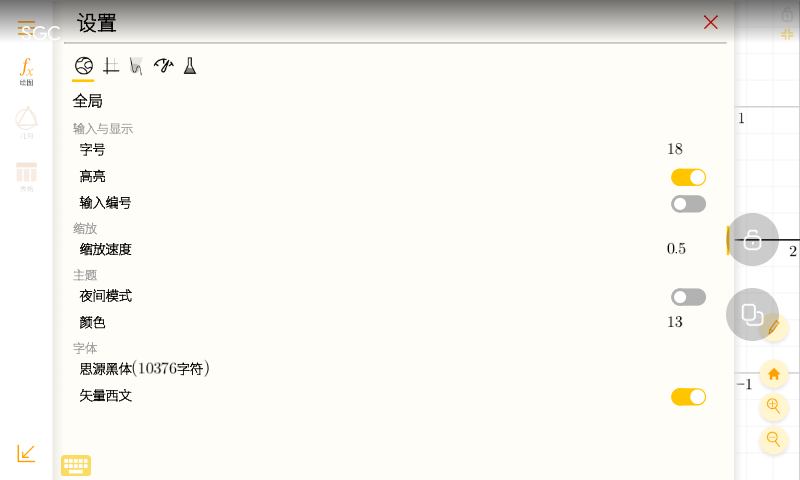
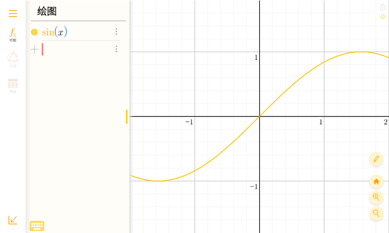

# 主界面

## 界面介绍

启动后看到的就是主界面：

- **模式区**（最左，白色）：切换平面 / 3D / 几何 / 表格等模式。
- **输入区**（左侧浅黄）：写表达式，每行左侧有显隐圆点、右侧有「⋯」。
- **图形区**（右侧网格）：绘制结果。右上角可锁定坐标系、全屏；右下角有回原点与缩放。

拖动输入区右侧的黄色分隔条可以改宽度；左下角的键盘图标打开虚拟键盘。

<figure markdown>
  { width="460" }
  <figcaption>主界面：最左是模式区，左侧输入区，右侧图形区</figcaption>
</figure>


## 菜单栏

| 菜单项 | 作用 |
| --- | --- |
| 文件 | 保存 / 打开 `.sgc`；导出设置 `json`（含坐标系位置与缩放） |
| 清屏 | 确认后清空输入，但**不还原设置** |
| 检测 | 跑基准测试，基准分 1000；会改设置，测完建议重启 |
| 切换模式 | 平面 ↔ 3D |
| 设置 | 打开[设置](settings.md) |
| 关于 | 版本信息 |
| 高级功能 | 动画模式、脚本终端 |
| 素材集市 | 打开素材库 |

<figure markdown>
  { width="460" }
  <figcaption>菜单栏：文件、检测、清屏、切换模式、设置、关于、素材集市、高级功能</figcaption>
</figure>


设置 json 的结构如下（`SGCjson` 为 `v0.2`）：

```json
{
  "SGCjson": "v0.2",
  "fontsize": 18, "highlight": 1,
  "sfspeed": 0.5,
  "mode": 1,
  "axis": 1, "NumOfAxis": 1, "grid": 1,
  "FPS": 0, "Temp": 0, "MousePos": 0, "loadIcon": 1,
  "SpecialPoints": 0, "dtrecalc": 0, "InputNum": 0,
  "pqmin": 0, "pqmax": 6.283185307179586,
  "pqprec": 400, "pqminexp": 0, "pqmaxexp": "2π",
  "polmin": 0, "polmax": 6.283185307179586,
  "polprec": 400, "polminexp": 0, "polmaxexp": "2π",
  "dx": 0, "dy": 0, "sf": 0
}
```

## 键盘

打开键盘后，上方有橙色圆框和一排按钮：`123`（数字与符号）、`f(x)`（函数）、
`abc`（字母）、`+`（外部导入）、喇叭（播放当前函数的声音）。

- **123**：0–9、`π`、`e`、`x`、`y`、`z`，以及 `+ - * / ^` 等运算符。
- **f(x)**：三角函数、特殊函数；`text` 按钮插入一对引号。
- **abc**：字母与常数；蓝色上箭头是 shift，按下后左上角出现 `S↑`，部分按键会变。
- 长按可连续输入；红色小叉关闭键盘；输入区隐藏后无法打开键盘。
- `enter` 把内容写入输入区并绘制；错误的表达式也会被写入，空白内容不会。
- Shift + 左右键：跳到当前表达式开头 / 结尾。

<figure markdown>
  { width="460" }
  <figcaption>虚拟键盘：123 数字与符号、f(x) 函数、abc 字母</figcaption>
</figure>


!!! note "原版 Scratch"
    原版 Scratch 3 不支持 backspace，删除键用 `\` 代替，长按可快速删除。

## 素材库

素材库分几何、函数、隐式、抽象、脚本等几类。脚本类素材需要运行脚本才能看到效果：
点开示例（如「80E 正 257 边形（脚本演示作图步续）」）→ 确定 → 菜单 → 高级功能 → 脚本 → 运行。

<figure markdown>
  { width="460" }
  <figcaption>素材库：几何、函数、隐式、抽象、脚本等分类</figcaption>
</figure>
