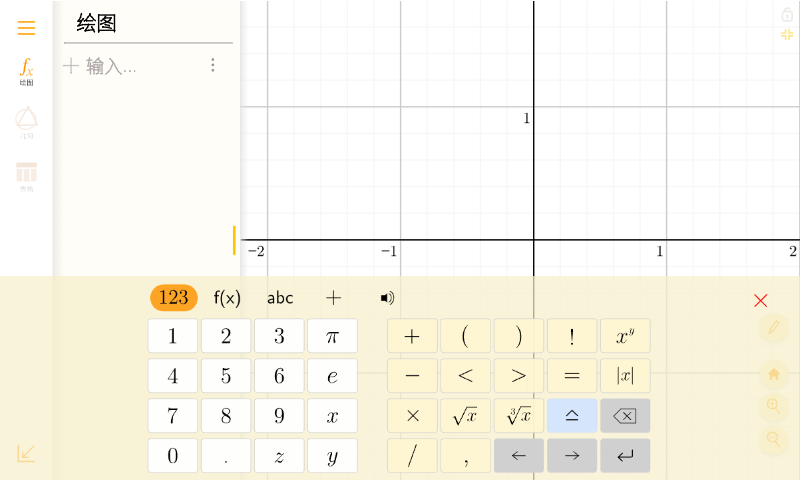

# 快速开始

## 打开

在 Scratch 里点小绿旗启动计算器，或直接访问 [在线版](https://sqy419.axolotlpower.com/sgc/v4/calculator/)。

界面分三块：最左是**模式区**，左边浅黄色是**输入区**，右边带网格的是**图形区**。
点汉堡按钮可以打开菜单，左下角的按钮可以收起输入区、只看图形。

## 画第一条函数

在输入区键入：

```text
sin(x)
```

按 `enter`（或虚拟键盘上的箭头）才会解析并绘制——**SGC 没有输入预览**，不按 enter 是不会出图的。

<figure markdown>
  { width="460" }
  <figcaption>输入 sin(x) 后按 enter，图形区出现曲线</figcaption>
</figure>


## 调参

```text
a=1
b=3
a*sin(b*x)
```

`a`、`b` 会各自生成滑动条，拖动即可实时改变图形。
注意：变量值必须是一个纯实数才会变成可播放变量，`a=sqrt(2)` 是常量，没有滑动条；
想要常量 `a=1` 可以写 `a=1+0`。

## 常用操作

| 操作 | 方式 |
| --- | --- |
| 平移坐标系 | 按住网格拖动 |
| 缩放 | 滚轮（以鼠标为中心），或右下角放大镜 |
| 回到原点 | 右下角小房子 |
| 锁定坐标系 | 右上角锁图标 |
| 显隐某个对象 | 点输入行左侧的彩色圆点 |
| 更多操作 | 输入行右侧「⋯」 |

## 保存

菜单 → 文件：可以保存/打开 `.sgc` 文件，也可以导出设置 `json`（含坐标系位置与缩放）。

## 想画隐函数？

```text
sin(xx+yy)=0
```

隐函数必须在**最外层**有等号或不等号。`sin(xx+yy)` 会被当成二元显函数 `z=sin(xx+yy)`，
在 3D 模式里显示；`(sin(xx+yy)=0)` 则被当成布尔表达式。

## 下一步

- [输入](input.md)：自动补全、变量、函数、参数方程、极坐标
- [计算引擎](engine.md)：函数表与 `sum` / `int` / `diff` / `fSolve`
- [常见问题](faq.md)：画不出图、精度不够、定义域限制
